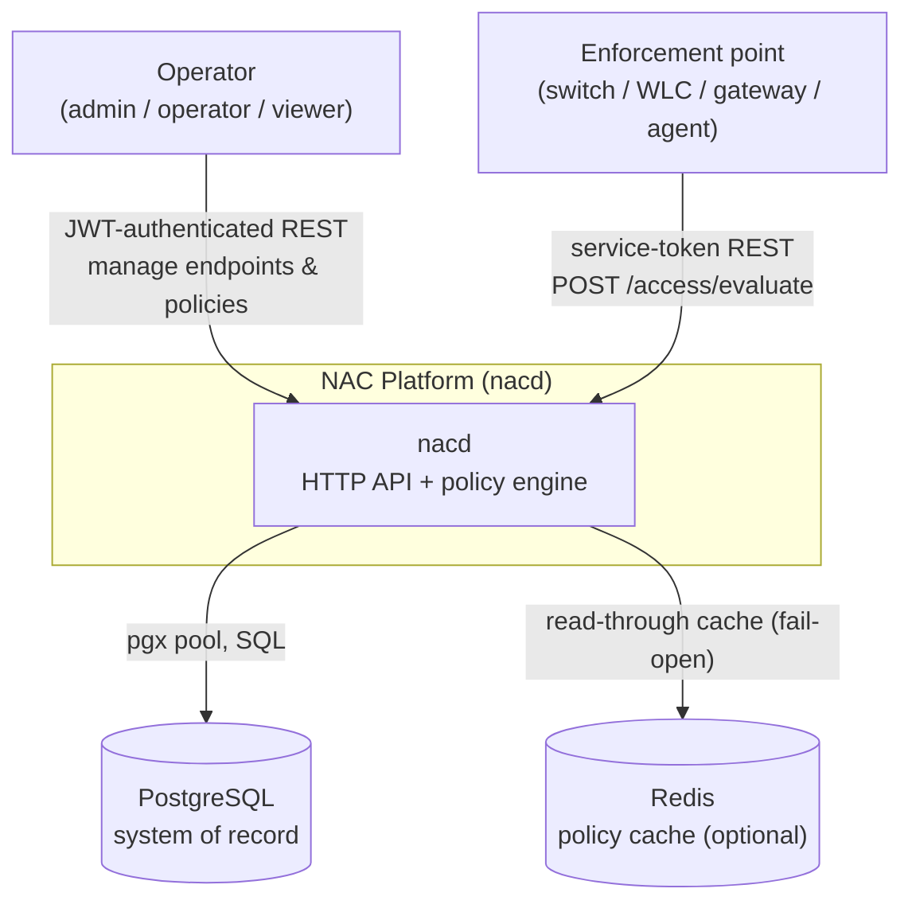
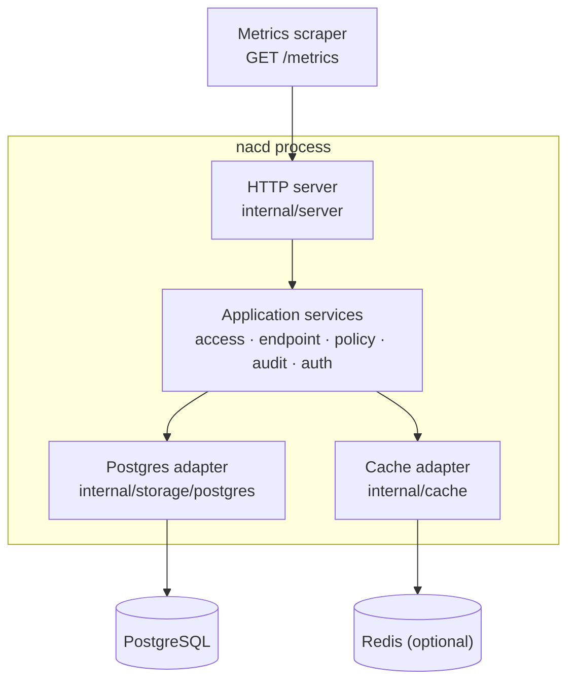
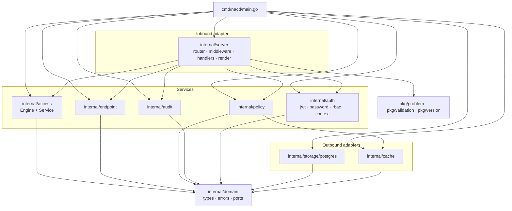
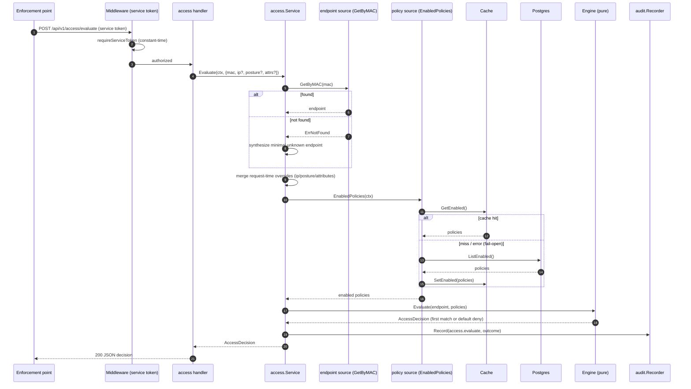
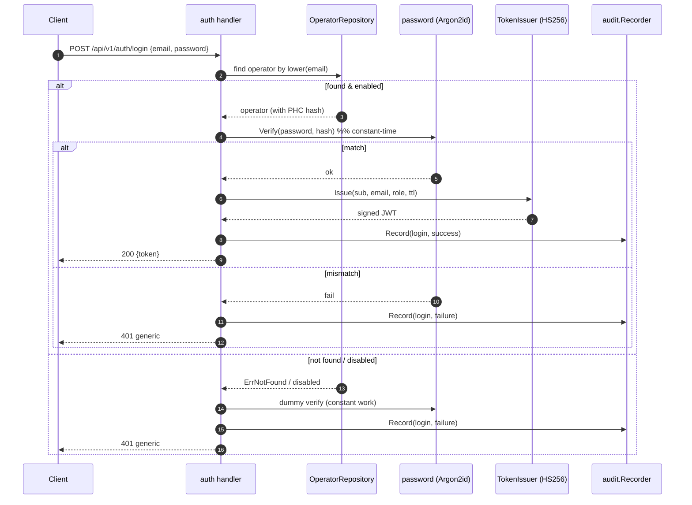
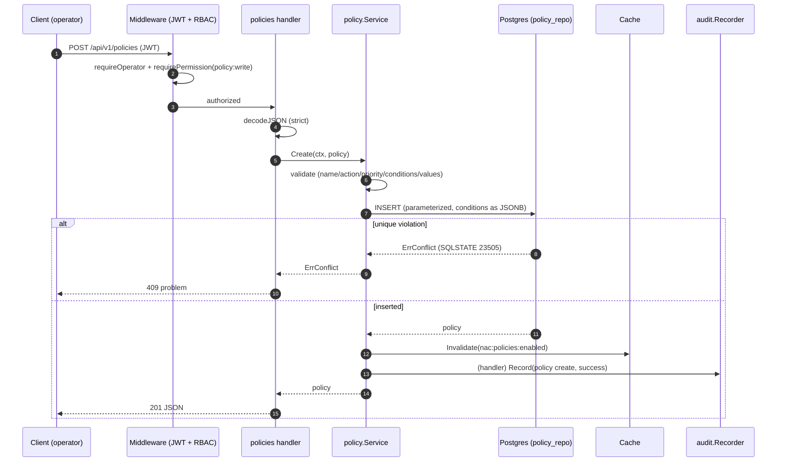
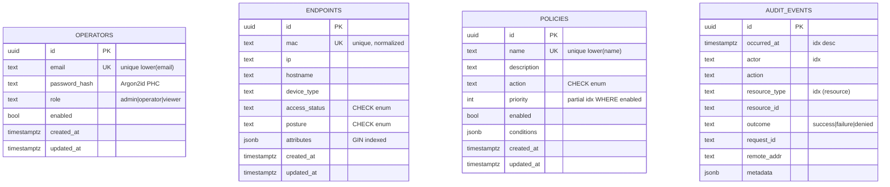

# Architecture Diagrams

A consolidated collection of Mermaid diagrams for the NAC platform: system context,
containers, internal components, key sequences (access evaluation, operator login, create
policy with cache invalidation), and the entity-relationship model.

These expand on the diagrams embedded in the [Architecture Overview](./overview.md) and
[Low-Level Design](./low-level-design.md). The authoritative ERD also appears in the
[Database Schema](../database/schema.md).

---

## (a) System context (C4 level 1)

The platform sits between operators (humans administering policy) and enforcement points
(switches, wireless controllers, gateways, or agents that ask "should this device get
access?"). It persists to PostgreSQL and optionally caches enabled policies in Redis.

The two inbound actors authenticate differently: operators present a JWT and are gated by
RBAC; enforcement points present a shared **service token**. Redis is optional — if it is
absent or unreachable, the engine reads enabled policies straight from Postgres.

---

## (b) Container diagram (C4 level 2)

Inside the single `nacd` process, the inbound HTTP adapter delegates to application services,
which use outbound adapters for persistence and caching. There is one deployable binary; the
"containers" here are logical runtime collaborators.

`cmd/nacd/main.go` is the composition root: it loads config, builds the logger, connects the
pool, runs embedded migrations, optionally connects Redis, constructs repositories and
services, optionally bootstraps an admin, builds the server, and serves with graceful
shutdown on SIGINT/SIGTERM.

---

## (c) Component diagram (internal packages)

The package dependency graph follows the hexagonal rule: everything points inward toward
`internal/domain`, which imports no other internal package. Adapters implement the port
interfaces declared in `domain`; only `main` binds interfaces to concretions.

Note that `internal/policy` depends on the `PolicyCache` port; the concrete `internal/cache`
implements it. `internal/server` depends on service *interfaces* (declared in the server
package) rather than concrete services, which keeps handlers unit-testable with fakes.

---

## (d) Sequence: access evaluation

An enforcement point asks whether a device (by MAC) should be granted access. The access
service resolves the endpoint, merges any request-time context, fetches enabled policies
(cache-first), and runs the pure engine. The decision is audited best-effort.

The engine sorts policies by `(priority asc, name asc)`, applies first-match-wins with all
conditions AND-ed, and returns a secure **default deny** when nothing matches. See the
[engine algorithm](./low-level-design.md#3-internalaccess--the-policy-engine-and-service).

---

## (e) Sequence: operator login

Login exchanges email + password for a short-lived JWT. The handler verifies the Argon2id
hash in constant time and, on success, issues an HS256 token. Failures return a generic
`401` to resist account enumeration.

The dummy-verify branch keeps the response time roughly constant whether or not the account
exists, mitigating timing-based enumeration. See
[AuthN/AuthZ](../security/authn-authz.md).

---

## (f) Sequence: create policy (with cache invalidation)

Creating or mutating a policy must not leave the enabled-policy cache stale. After a
successful write, the policy service invalidates the cache so the next `EnabledPolicies`
read repopulates it from the database.

Every mutation path (`Create`, `Update`, `Delete`) calls `cache.Invalidate`; an invalidation
failure is logged but not propagated, and because the cache fails open the next read still
returns correct data from Postgres.

---

## (g) Entity-relationship diagram

The relational model has four tables created by migration `0001_init`. There are no foreign
keys between them by design — `audit_events` references actors and resources by id/type as
loosely-coupled strings so the append-only log is never blocked by referential integrity.
The authoritative version with column types and indexes lives in
[Database Schema](../database/schema.md).

`policies_enabled_priority_idx` is a **partial** index on `(priority) WHERE enabled`,
matching the engine's hot path (read enabled policies ordered by priority). `endpoints` has a
GIN index on `attributes`; `audit_events` is indexed on `occurred_at desc`, `actor`, and
resource columns for fast forensic queries.

---

## See also

- [Architecture Overview](./overview.md) · [Low-Level Design](./low-level-design.md)
- [Business Logic](./business-logic.md)
- [Database Schema](../database/schema.md) · [Migration Guide](../database/migrations.md)
- [AuthN/AuthZ](../security/authn-authz.md) · [Audit Logging](../security/audit-logging.md)
- [Threat Model](../security/threat-model.md) · [Trust Boundaries](../security/trust-boundaries.md)
