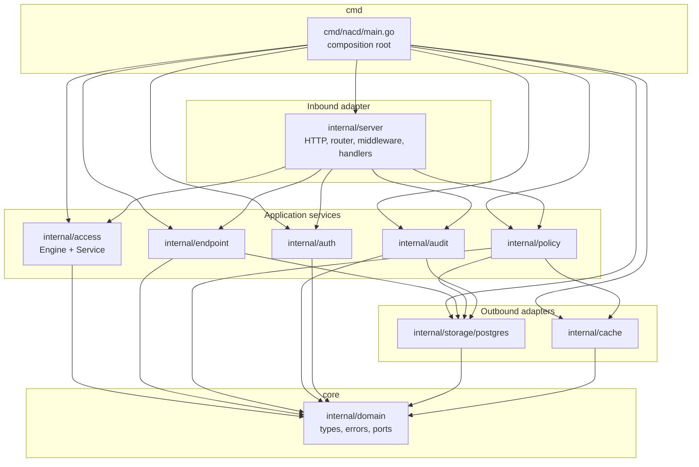
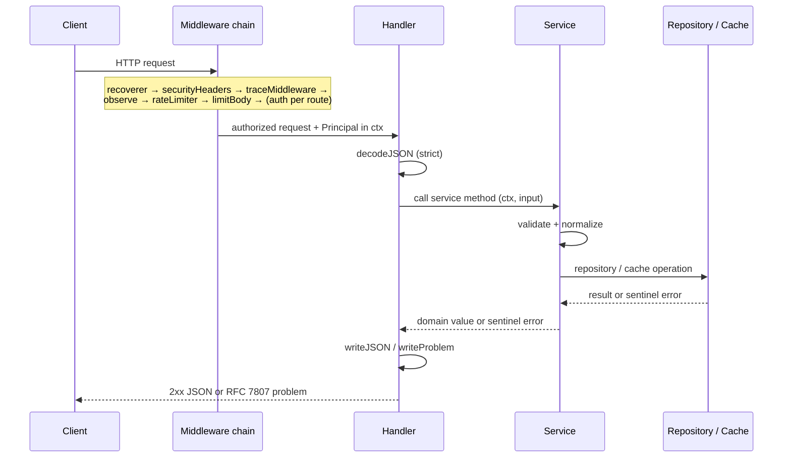

# Low-Level Design

This document describes the internal design of the NAC platform package-by-package: the
responsibilities of each Go package, its key types and functions, the end-to-end request
flow, error mapping, the policy-evaluation algorithm, validation rules, and the
concurrency/safety properties that the implementation relies on.

It complements the higher-level [Architecture Overview](./overview.md) and
[Business Logic](./business-logic.md) documents, and the visual collection in
[Diagrams](./diagrams.md). For data shapes see [Database Schema](../database/schema.md);
for security specifics see [AuthN/AuthZ](../security/authn-authz.md) and the
[Threat Model](../security/threat-model.md).

The system follows a hexagonal (ports-and-adapters) architecture. The decision is recorded
in [ADR-0002](../../adr/0002-hexagonal-architecture.md).

---

## 1. Package map and dependency direction

The dependency rule is strict: the `domain` package depends on **no** other internal
package. Service packages depend on `domain` (its types, sentinel errors, and port
interfaces). Adapters (storage, cache, server) depend on `domain` and on the service
packages they wire together. Nothing in `domain` ever imports an adapter — dependencies
point inward.



> **Reading the diagram.** Arrows point from a dependent to its dependency. Every arrow
> ultimately terminates at `internal/domain`. Services depend on the port *interfaces*
> declared in `domain`; the concrete `postgres` and `cache` adapters *implement* those
> interfaces, so at compile time the services never name a concrete adapter — `main` is the
> only place where interfaces are bound to implementations (the composition root).

---

## 2. `internal/domain` — the core

The core defines the language of the system and imports no other internal package.

| File | Contents |
|------|----------|
| `types.go` | Entities and value objects: `Endpoint`, `Policy`, `Condition`, `AccessDecision`, `Operator`, `AuditEvent`. Enums `AccessStatus`, `PostureStatus`, `PolicyAction`, `MatchOperator`, `Role`, each with a `Valid()` method. |
| `errors.go` | Sentinel errors: `ErrNotFound`, `ErrConflict`, `ErrUnauthorized`, `ErrForbidden`, `ErrInvalidInput`. |
| `ports.go` | Port interfaces and supporting types. |

### Ports

```go
type EndpointRepository interface { /* Create/Get/GetByMAC/Update/Delete/List */ }
type PolicyRepository   interface { /* Create/Get/Update/Delete/List + ListEnabled */ }
type OperatorRepository interface { /* lookup by id/email, create */ }
type AuditRepository    interface { /* Append + List (append-only) */ }
type PolicyCache        interface { GetEnabled(...); SetEnabled(...); Invalidate(...) }

type Page          struct { Limit, Offset int }
type EndpointFilter struct { AccessStatus AccessStatus; Search string }
```

The `Valid()` methods give every enum a single authoritative validation point that both the
service layer and the database `CHECK` constraints mirror. Sentinel errors are the contract
between layers: a repository returns `ErrNotFound`/`ErrConflict`, a service may return
`ErrInvalidInput`/`ErrForbidden`/`ErrUnauthorized`, and the HTTP layer maps these to status
codes (see §6).

---

## 3. `internal/access` — the policy engine and service

### 3.1 `engine.go` — the pure engine

The `Engine` is **pure and stateless**: given the same inputs it produces the same output,
performs no I/O, and holds no mutable shared state. The only external dependency is an
**injectable clock** (for deterministic timestamps in tests).

Algorithm (precise pseudocode):

```
function Evaluate(endpoint, policies):
    # 1. Defensive copy so callers' slices are never mutated.
    p := copy(policies)

    # 2. Stable, deterministic ordering: ascending priority, then name.
    stableSort(p, by=(priority asc, name asc))

    # 3. First-match-wins.
    for each policy in p:
        if policyMatches(policy, endpoint):
            return AccessDecision{
                status:  actionToStatus(policy.action),
                policyID: policy.id,
                reason:  "matched policy " + policy.name,
                at:      clock.Now(),
            }

    # 4. No policy matched → secure default: DENY.
    return AccessDecision{ status: deny, reason: "default deny", at: clock.Now() }

function policyMatches(policy, endpoint):
    # All conditions must hold (logical AND). Zero conditions ⇒ matches.
    for each cond in policy.conditions:
        if not conditionMatches(cond, endpoint):
            return false
    return true

function conditionMatches(cond, endpoint):
    value, present := lookupField(endpoint, cond.field)
    switch cond.operator:
        case "eq":     return present and value == cond.values[0]
        case "ne":     return (not present) or value != cond.values[0]   # ne is TRUE on a missing field
        case "in":     return present and value ∈ cond.values
        case "exists": return present
        default:       return false                                       # unknown operator → fail closed
```

Three safety properties are deliberate and load-bearing:

1. **Secure default deny.** When no policy matches, the decision is `deny`
   ([ADR-0003](../../adr/0003-default-deny-policy-engine.md)).
2. **Unknown operator fails closed.** A condition with an unrecognized operator never
   matches, so a malformed/forward-incompatible policy cannot accidentally grant access.
3. **`ne` is true on a missing field.** "Not equal to X" holds when the field is absent —
   consistent with set semantics where the attribute is not in the (singleton) excluded set.

### 3.2 `service.go` — the access service

The `Service` wires the pure `Engine` to two function-typed sources so it can be tested
without a database:

- `policySource` → `EnabledPolicies(ctx)` (served via the policy service / cache).
- `endpointSource` → `GetByMAC(ctx, mac)`.

Evaluation flow:

1. Normalize and resolve the endpoint by **MAC**.
2. If the endpoint is **not found**, tolerate it: synthesize a *minimal unknown endpoint*
   (so unknown devices are still evaluated, and the default-deny applies meaningfully).
3. **Merge request-time overrides** — request-supplied `ip`, `posture`, and `attributes`
   override the stored values. This lets an enforcement point supply live context.
4. Fetch `EnabledPolicies` and call `engine.Evaluate`.

---

## 4. Entity services

### 4.1 `internal/endpoint/service.go`

CRUD with normalization and validation: `Create`, `Get`, `Update`, `Delete`, `List`.

- MAC is normalized (canonical form) and validated; **MAC is immutable on update**.
- IP validated via `net.ParseIP`.
- New endpoints default to `access_status = unknown` and `posture = unknown`.
- Pagination clamp: default `Limit = 50`, maximum `200`.

### 4.2 `internal/policy/service.go`

CRUD plus `EnabledPolicies`: `Create`, `Get`, `Update`, `Delete`, `List`, `EnabledPolicies`.

- Validation (see §7) covers name, description, action, priority, and per-condition rules.
- **Every mutation calls `cache.Invalidate`** so the enabled-policy cache cannot serve
  stale rules after a create/update/delete.
- `EnabledPolicies` is a **read-through cache**: serve from cache, else load from DB, then
  populate the cache.

### 4.3 `internal/audit/audit.go`

`Recorder.Record(ctx, action, resourceType, resourceID, outcome, meta)`:

- Pulls the **actor** from the principal in context, the **request_id** from the trace span
  id, and the **remote address** from context.
- Appends to `AuditRepository` and emits a structured log line.
- **Best-effort vs request:** an audit-append failure is *logged but does not fail the
  operation*. This is a documented tradeoff — see [Audit Logging](../security/audit-logging.md).
- Outcomes: `success`, `failure`, `denied`.

---

## 5. Cross-cutting packages

### 5.1 `internal/auth`

| File | Responsibility |
|------|----------------|
| `password.go` | Argon2id hashing. Params: memory 64 MiB, time `t=3`, parallelism `p=2`, salt 16 B, key 32 B. Stored in PHC format `$argon2id$v=19$m=…,t=…,p=…$salt$hash`. Constant-time comparison; `ErrInvalidHash` on a malformed string. |
| `jwt.go` | `TokenIssuer` using HS256, key `>= 32 B` enforced, `ttl > 0`. `Issue` sets `sub` (operator id), `email`, `role`, `iss`, `aud`, `iat`/`nbf`/`exp`, `jti`. `Parse` **pins HS256** (rejects `alg=none` and algorithm confusion), validates `iss`/`aud`/`exp`, and requires an expiry. |
| `rbac.go` | Static role→permission map. Permissions: `endpoint:read`/`write`, `policy:read`/`write`, `access:evaluate`, `audit:read`, `operator:manage`. `HasPermission` is **fail-closed** for an unknown role. |
| `context.go` | `Principal{ID, Email, Role}` carried in `context.Context`. |

See [AuthN/AuthZ](../security/authn-authz.md) and
[ADR-0004](../../adr/0004-auth-jwt-argon2-rbac.md).

### 5.2 `internal/cache`

`NoopCache` (no-op for the no-Redis deployment) and `RedisCache`. Key
`nac:policies:enabled`, TTL-bounded, JSON-encoded. **Fail-open:** a decode failure or any
Redis error is treated as a cache *miss*, falling back to the database; `SET`/`Invalidate`
failures are logged, not propagated. `Connect` pings with a 5 s timeout.

### 5.3 `internal/storage/postgres`

| File | Responsibility |
|------|----------------|
| `db.go` | `Connect` builds a `pgxpool` with `MaxConns`/`MinConns`/`MaxConnLifetime` and a 5 s ping. `Migrate` applies embedded `migrations/*.up.sql` in lexical order, each in its own transaction, recording `schema_migrations(version, applied_at)`; idempotent. `isUniqueViolation` maps SQLSTATE `23505` → `ErrConflict`; "no rows" → `ErrNotFound`. |
| `endpoint_repo.go`, `policy_repo.go`, `operator_repo.go`, `audit_repo.go` | Parameterized SQL, `NULLIF` for optional text, JSONB marshal/unmarshal for `attributes`/`conditions`/`metadata`, scan helpers. `audit_repo` has **no** update/delete (append-only). |

See [Migration Guide](../database/migrations.md).

### 5.4 `internal/server` and `pkg`

| File / pkg | Responsibility |
|------------|----------------|
| `server.go` | `Deps` + `Server`. Depends on service *interfaces* (`endpointService`, `policyService`, `accessService`) for testability; a `Ready` func backs readiness; injectable `now`. |
| `router.go` | `http.ServeMux` method+pattern routes; per-route auth tiers; a global middleware chain. |
| `middleware.go` | `statusRecorder`, `traceMiddleware`, `securityHeaders`, `recoverer`, `observe` (metrics + log), `limitBody` (`MaxBytesReader`), `requireOperator` (JWT), `requirePermission` (RBAC), `requireServiceToken` (constant-time), `rateLimiter` (in-process fixed window per client IP), `routePattern` (from `r.Pattern`, bounding metric label cardinality). |
| `render.go` | `writeJSON`; `decodeJSON` (strict — `DisallowUnknownFields`, single object); `writeProblem` (domain sentinel → RFC 7807); `badRequest`; `drainAndClose`. |
| `handlers_*.go` | `auth`, `endpoints`, `policies`, `access`, `system`. |
| `pkg/problem` | RFC 7807 `Details`. |
| `pkg/validation` | `NormalizeMAC`, `IsEmail`, `IsIP`, `MaxLen`, `NonEmpty`, `Errors` accumulator. |
| `pkg/version` | `Version`/`Commit`/`BuildDate` set via `ldflags`. |

---

## 6. Request flow



The global chain wraps every route. Authentication is layered **per route**: public system
endpoints have none; `login` is public; operator routes require a valid JWT *and* the route
permission via RBAC; `POST /access/evaluate` requires a service token. See
[router/middleware](#54-internalserver-and-pkg) and the
[diagrams](./diagrams.md) for the auth tiers.

### Error mapping (domain sentinel → HTTP → RFC 7807)

`writeProblem` translates domain sentinels into RFC 7807 problem documents:

| Domain sentinel | HTTP status | RFC 7807 `type` (slug) | Typical cause |
|-----------------|-------------|------------------------|---------------|
| `ErrInvalidInput` | `400 Bad Request` | `about:blank#invalid-input` | Failed validation/normalization, malformed JSON. |
| `ErrUnauthorized` | `401 Unauthorized` | `about:blank#unauthorized` | Missing/invalid credentials, bad/expired JWT, login failure. |
| `ErrForbidden` | `403 Forbidden` | `about:blank#forbidden` | Authenticated but lacks the required permission. |
| `ErrNotFound` | `404 Not Found` | `about:blank#not-found` | Entity/route id does not exist. |
| `ErrConflict` | `409 Conflict` | `about:blank#conflict` | Unique violation (SQLSTATE 23505) — duplicate MAC/email/name. |
| *(unmapped / panic)* | `500 Internal Server Error` | `about:blank#internal` | Unexpected error; `recoverer` converts panics. |

Every problem body carries `type`, `title`, `status`, and `detail`. The strict decoder
rejects unknown fields and trailing data with `400`.

---

## 7. Validation rules per entity

### Endpoint

| Field | Rule |
|-------|------|
| `mac` | Required; normalized (`NormalizeMAC`); valid MAC; **immutable on update**. |
| `ip` | Optional; must parse via `net.ParseIP`. |
| `hostname` | Optional; length `<= 253`. |
| `device_type` | Optional; length `<= 128`. |
| `posture` | Must be a valid `PostureStatus` enum; defaults to `unknown` on create. |
| `access_status` | Defaults to `unknown` on create. |
| `attributes` | Max **50** keys; key length `<= 64`; value length `<= 512`. |

### Policy

| Field | Rule |
|-------|------|
| `name` | Required; length `<= 128`. |
| `description` | Optional; length `<= 1024`. |
| `action` | Must be a valid `PolicyAction`. |
| `priority` | Integer `>= 0`. |
| `conditions` | Max **20** conditions. |
| `condition.field` | Required; length `<= 128`. |
| `condition.operator` | Must be a valid `MatchOperator`. |
| `condition.values` | `<= 50` values; `eq`/`ne` require **exactly 1**; `in` requires `>= 1`. |

### Pagination

`Page` is clamped at the service layer: default `Limit = 50`, max `200`; `Offset >= 0`.

---

## 8. Concurrency and safety notes

- **Engine is stateless and pure.** It takes a defensive copy of the policy slice before
  sorting, so concurrent evaluations never race on caller-owned data and never mutate
  shared inputs. With an injectable clock it is fully deterministic.
- **Connection pool.** Postgres access goes through a single shared `pgxpool` sized by
  `MaxConns`/`MinConns`/`MaxConnLifetime`; the pool is safe for concurrent use, bounding
  database concurrency independent of HTTP concurrency.
- **Cache fails open.** Any Redis error or decode failure degrades to a database read; the
  system stays available (and correct) if Redis is down. Cache writes are best-effort.
- **In-process rate limiter.** `rateLimiter` is a fixed-window counter keyed by client IP,
  local to the process. It is a per-instance safeguard, **not** a cluster-wide quota; behind
  multiple replicas the effective limit scales with replica count.
- **Audit is best-effort.** A failed audit append does not fail the request; this trades a
  small completeness risk for request availability and is documented in
  [Audit Logging](../security/audit-logging.md).
- **Bounded metric labels.** `routePattern` derives the label from `r.Pattern`, not the raw
  path, preventing unbounded cardinality (and a memory-exhaustion vector) in metrics.

---

## See also

- [Architecture Overview](./overview.md)
- [Business Logic](./business-logic.md)
- [Diagrams](./diagrams.md)
- [Database Schema](../database/schema.md) · [Migration Guide](../database/migrations.md)
- [AuthN/AuthZ](../security/authn-authz.md) · [Audit Logging](../security/audit-logging.md)
- [Threat Model](../security/threat-model.md) · [Trust Boundaries](../security/trust-boundaries.md)
- ADRs: [0002](../../adr/0002-hexagonal-architecture.md),
  [0003](../../adr/0003-default-deny-policy-engine.md),
  [0004](../../adr/0004-auth-jwt-argon2-rbac.md),
  [0005](../../adr/0005-stdlib-router-no-orm.md)
