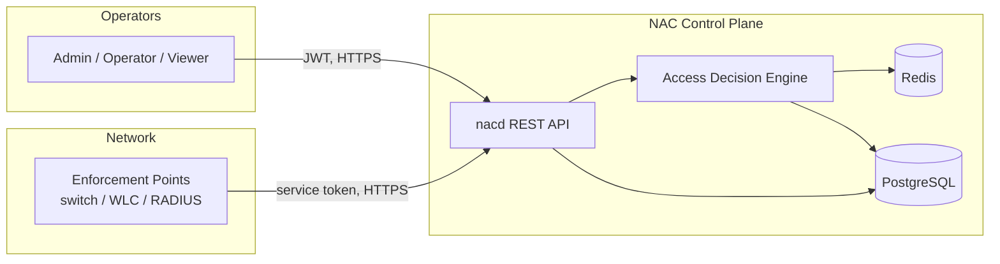
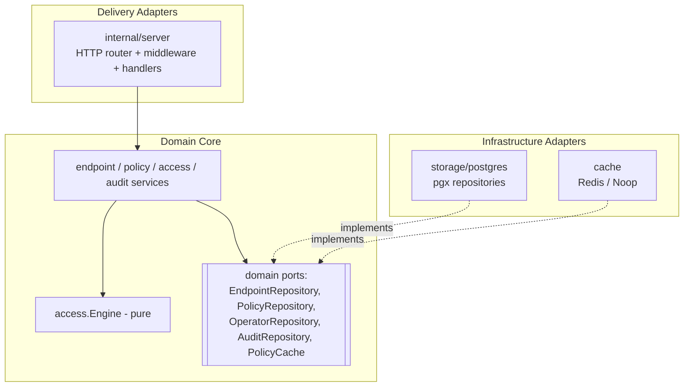
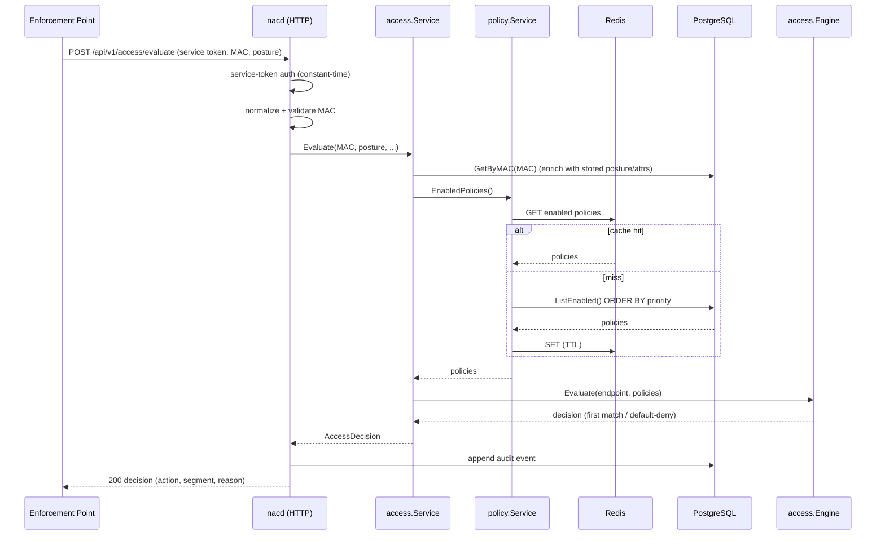
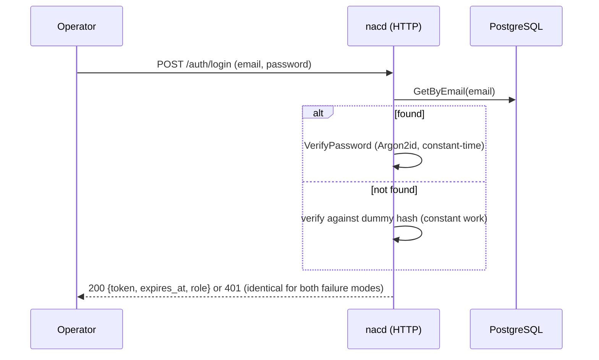
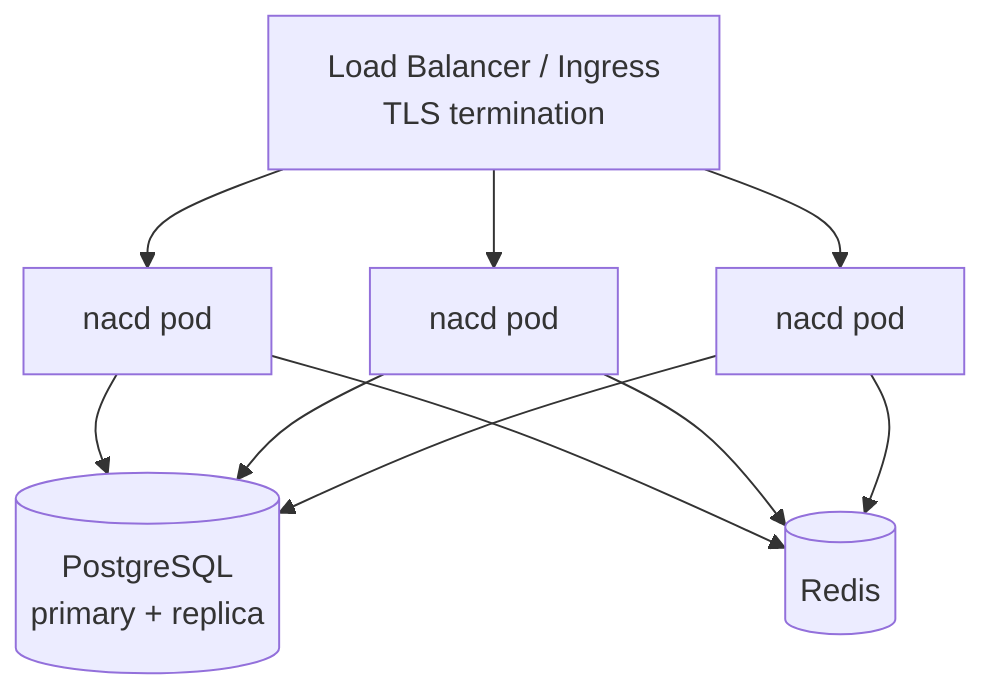

# Architecture Overview

This document describes the high-level design (HLD), component structure, and
key runtime flows of the NAC platform. Low-level details live in linked
documents; this is the map.

## 1. System context

`nac` is a network access-control **control plane**. It does not sit inline in
the data path; instead, network **enforcement points** (802.1X-capable
switches, wireless controllers, or a RADIUS bridge) ask `nac` for a decision
and then enforce it locally.



External posture-assessment systems may supply a device's compliance posture
either by updating the endpoint record (operator/integration) or by including a
posture signal in the evaluation request.

## 2. Quality goals (and how they are met)

| Goal | Mechanism |
|------|-----------|
| **Correctness** | Pure decision engine with exhaustive unit tests; DB CHECK constraints mirror domain enums. |
| **Security** | Default-deny, Argon2id, pinned-alg JWT, RBAC, RFC 7807, strict validation, audit log, constant-time secret compare. |
| **Scalability** | Stateless API (horizontal scale), Redis-cached hot path, connection pooling, HPA. |
| **Observability** | Structured logs, Prometheus metrics, trace propagation, health/readiness probes. |
| **Maintainability** | Hexagonal layering; the core imports no adapter. |
| **Simplicity** | Standard library HTTP, minimal dependencies, boring tech. |

## 3. Logical architecture (hexagonal)

The codebase is organized so that the **domain core** (types, the decision
engine, and service logic) depends only on **ports** (interfaces), never on
concrete infrastructure. Adapters implement the ports.



**Dependency rule:** arrows point inward. `internal/domain` and
`internal/access` import no other internal packages, which is why the most
security-critical code is trivially testable in isolation.

### Package responsibilities

| Package | Responsibility | Depends on |
|---------|----------------|------------|
| `internal/domain` | Entities, enums, errors, ports | (none internal) |
| `internal/access` | Decision engine + access service | `domain` |
| `internal/endpoint` | Endpoint lifecycle + validation | `domain`, `pkg/validation` |
| `internal/policy` | Policy lifecycle + cache coordination | `domain`, `pkg/validation` |
| `internal/audit` | Append-only audit recorder | `domain`, `auth`, `observability` |
| `internal/auth` | Argon2id, JWT, RBAC, principal | `domain` |
| `internal/config` | 12-factor config + validation | `domain` |
| `internal/observability` | Logging, metrics, tracing | (none internal) |
| `internal/server` | HTTP edge | all services, `auth`, `pkg/problem` |
| `internal/storage/postgres` | pgx repositories + migrations | `domain`, `config` |
| `internal/cache` | PolicyCache implementations | `domain`, `observability` |
| `cmd/nacd` | Composition root, lifecycle | everything |

## 4. Request lifecycle & middleware stack

Every request passes through a deliberately ordered middleware chain
(`internal/server/router.go`):

```
recoverer → trace+logger → securityHeaders → observe → rateLimit → limitBody → route
```

1. **recoverer** — converts panics into clean 500s.
2. **trace+logger** — derives/propagates a W3C trace context and attaches a
   correlation-bearing logger; echoes `traceparent` and `X-Request-Id`.
3. **securityHeaders** — `nosniff`, `DENY` framing, strict CSP, `no-store`.
4. **observe** — records metrics (bounded-cardinality route label) and access log.
5. **rateLimit** — per-client fixed-window limiter (cheap rejection).
6. **limitBody** — caps request body size before any handler reads it.

Authentication and authorization are applied **per route**, because the public
(health/login/openapi), operator (JWT+RBAC), and enforcement-point
(service-token) endpoints have different requirements.

## 5. Core sequence: access evaluation

This is the hottest and most security-critical path.



## 6. Core sequence: operator login



The "constant work on unknown user" step removes a user-enumeration timing
oracle — see the [Threat Model](../security/threat-model.md).

## 7. Data architecture

PostgreSQL is the **system of record**; Redis is a **disposable cache** of the
enabled-policy set. Losing Redis degrades latency, never correctness (the cache
fails open to the database). See [Database Design](../database/schema.md).

## 8. Deployment topology

`nacd` is stateless and horizontally scalable. A typical production topology:



TLS is terminated at the ingress/load balancer. See
[Scalability Strategy](../operations/scalability.md) and the Kubernetes
manifests in `deployments/kubernetes/`.

## 9. Related documents

- [Business Logic & Domain Model](business-logic.md)
- [Low-Level Design](low-level-design.md)
- [Threat Model](../security/threat-model.md) · [Trust Boundaries](../security/trust-boundaries.md)
- [Database Design & ERD](../database/schema.md)
- [Architecture Decision Records](../../adr/README.md)
