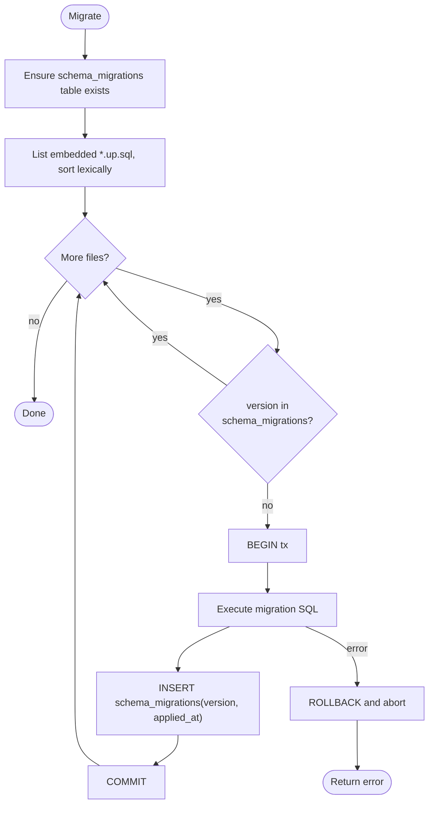

# Migration Guide

This guide covers how schema migrations work in the NAC platform: the file-naming
convention, the embedded transactional runner, how migrations are applied, how to author a
new one safely, the rollback model, zero-downtime guidance, and how to verify which versions
are applied.

The data model these migrations build is documented in [Database Schema](../database/schema.md).
The decision to use raw SQL with an embedded runner (no ORM) is recorded in
[ADR-0005](../../adr/0005-stdlib-router-no-orm.md); the broader stack choice in
[ADR-0001](../../adr/0001-go-postgres-redis-stack.md).

---

## 1. Where migrations live

```
internal/storage/postgres/migrations/
├── 0001_init.up.sql      # creates operators, endpoints, policies, audit_events
└── 0001_init.down.sql    # drops them
```

Migration files are **embedded into the `nacd` binary** at build time (Go `embed`). There is
no separate migrations directory to ship or mount — the binary is self-sufficient.

---

## 2. Naming convention

```
NNNN_name.up.sql      forward migration
NNNN_name.down.sql    matching rollback
```

| Part | Rule |
|------|------|
| `NNNN` | Zero-padded, monotonically increasing version, e.g. `0001`, `0002`, `0042`. Determines apply order. |
| `name` | Short snake_case description, e.g. `init`, `add_endpoint_owner`, `index_audit_action`. |
| `.up.sql` | Applied to move the schema **forward**. Required. |
| `.down.sql` | Manual rollback for the same version. Authored for completeness; not run automatically. |

The runner orders migrations **lexically** by filename. Because `NNNN` is zero-padded and
fixed-width, lexical order equals numeric order. Never renumber or rewrite a version that has
shipped — allocate the next number instead.

---

## 3. The embedded transactional runner

`internal/storage/postgres/db.go` exposes `Migrate`. Its semantics:

- **Embedded source.** It reads `migrations/*.up.sql` from the embedded filesystem.
- **Lexical order.** Files are sorted by name and applied in that order.
- **Per-migration transaction.** Each `*.up.sql` runs inside its **own** transaction. If a
  migration fails, that transaction rolls back and `Migrate` stops — earlier, already-applied
  migrations remain committed.
- **Ledger.** Within the same transaction, the runner inserts
  `schema_migrations(version, applied_at)`. The `schema_migrations` table is created by the
  runner itself (it is not part of `0001_init`).
- **Idempotent.** A migration whose `version` is already present in `schema_migrations` is
  skipped, so running `Migrate` repeatedly is safe.



> **Caveat — non-transactional statements.** A few PostgreSQL statements cannot run inside a
> transaction block, most notably `CREATE INDEX CONCURRENTLY`. Because every migration runs
> in its own transaction, such statements will fail. See [§5](#5-zero-downtime-guidance) for
> how to handle large index builds.

---

## 4. Applying migrations

| Method | Command | When |
|--------|---------|------|
| Migrate and exit | `nacd -migrate` | CI/CD step, or a one-shot job before rolling out app pods. Applies all pending migrations, then exits. |
| On boot | *(default startup)* | `cmd/nacd/main.go` runs migrations as part of normal startup, before building the server. Convenient for single-instance and dev. |
| Make target | `make migrate` | Local convenience wrapper around `nacd -migrate`. |
| Integration tests | `make test-integration` | Spins up a database and applies migrations before running the suite. |

The composition root applies migrations during startup, so a freshly deployed binary
converges the schema automatically. For multi-replica rollouts, prefer the explicit
`nacd -migrate` job (or `make migrate`) as a discrete pipeline stage so schema changes land
**once**, deterministically, before application replicas start — rather than racing N pods
that each call `Migrate` on boot (the per-migration transaction + idempotent ledger make the
race safe, but a single ordered step is easier to reason about and observe).

---

## 5. Authoring a new migration

Create a new pair with the next version number:

```
internal/storage/postgres/migrations/0002_add_endpoint_owner.up.sql
internal/storage/postgres/migrations/0002_add_endpoint_owner.down.sql
```

Follow this discipline:

1. **Forward-only mindset.** Treat applied migrations as immutable history. Never edit a
   shipped `*.up.sql`; fix forward with a new version.
2. **Additive changes preferred.** Add columns as nullable or with a safe default; add new
   tables and indexes. Avoid destructive changes (drop/rename column, narrow a type) in the
   same release that deploys code depending on the old shape.
3. **Backfills are separate from schema.** Add the column first (cheap, fast). Backfill data
   in batches — either in a later migration or an out-of-band job — so a single transaction
   does not lock a large table for the whole backfill.
4. **Mirror enum changes in two places.** Enum values are enforced both by `domain` `Valid()`
   methods and by SQL `CHECK` constraints. If you widen an enum, update the `CHECK` constraint
   *and* the corresponding `domain` enum together.
5. **Index creation caveat.** `CREATE INDEX` takes a lock that can stall writes on a large,
   busy table. `CREATE INDEX CONCURRENTLY` avoids the lock **but cannot run in a
   transaction** — and every migration here runs in a transaction. For large hot tables,
   build the index out-of-band (a DBA-run `CONCURRENTLY` statement, or a dedicated
   non-transactional tooling step) and record the version in `schema_migrations` so the
   embedded runner treats it as applied.
6. **Always write the `.down.sql`.** Even though it is not auto-applied, the rollback file
   documents intent and gives operators a reviewed path to reverse a change.

Example forward migration:

```sql
-- 0002_add_endpoint_owner.up.sql
ALTER TABLE endpoints
    ADD COLUMN owner_email text;

CREATE INDEX endpoints_owner_email_idx
    ON endpoints (owner_email);
```

```sql
-- 0002_add_endpoint_owner.down.sql
DROP INDEX IF EXISTS endpoints_owner_email_idx;
ALTER TABLE endpoints
    DROP COLUMN IF EXISTS owner_email;
```

---

## 6. Rollback model

- The runner is **forward-only**: it has no automatic "down" command. `*.down.sql` files
  exist for **manual** rollback, reviewed and executed deliberately by an operator/DBA.
- **Production discipline.** Rolling a schema backward in production is risky (data already
  written into new columns/tables is lost on a drop). Prefer **fix-forward**: ship a new
  `NNNN` migration that corrects the issue. Reserve `*.down.sql` for local development resets
  and for emergency, reviewed reversals.
- If you manually apply a `*.down.sql`, also delete the corresponding row from
  `schema_migrations` so the runner will re-apply the matching `*.up.sql` next time.

```sql
-- Manual rollback of version 0002 (review carefully in production):
BEGIN;
\i internal/storage/postgres/migrations/0002_add_endpoint_owner.down.sql
DELETE FROM schema_migrations WHERE version = '0002';
COMMIT;
```

---

## 7. Zero-downtime guidance

To deploy schema changes without an outage, decouple schema changes from code that uses them
using the **expand / migrate / contract** pattern:

| Phase | Action |
|-------|--------|
| **Expand** | Additive migration only: add nullable column / new table / new index. Old code keeps working; new shape is dormant. |
| **Deploy code** | Roll out application replicas that can *write* the new shape (dual-write or write-through) while still reading the old. |
| **Migrate data** | Backfill in batches out-of-band. |
| **Switch reads** | Deploy code that reads the new shape. |
| **Contract** | A later release drops the now-unused old column/constraint — never in the same release that stopped using it. |

Additional rules for hot tables:
- Add columns **nullable** or with a constant default (avoid a rewrite-the-whole-table
  default on very large tables).
- Build indexes **concurrently** out-of-band (see [§5](#5-authoring-a-new-migration)).
- Validate new `CHECK` / `NOT VALID` constraints in a separate step to avoid a long
  full-table scan under lock.

---

## 8. Verifying applied versions

The `schema_migrations` ledger is the source of truth:

```sql
-- Which versions have been applied, newest first?
SELECT version, applied_at
FROM schema_migrations
ORDER BY version;
```

A pending-but-unapplied migration will be absent from this table. To confirm the binary's
embedded set matches what is applied, compare the rows above against the `NNNN` prefixes in
`internal/storage/postgres/migrations/`. Running `nacd -migrate` again is a safe way to bring
the database to the binary's expected version: already-applied versions are skipped and only
pending ones run.

---

## See also

- [Database Schema](./schema.md) — tables, columns, indexes, ERD
- [Low-Level Design](../architecture/low-level-design.md) — storage adapter and `Migrate`
- [Architecture Overview](../architecture/overview.md)
- ADRs: [0001 stack](../../adr/0001-go-postgres-redis-stack.md),
  [0005 stdlib router / no ORM](../../adr/0005-stdlib-router-no-orm.md)
