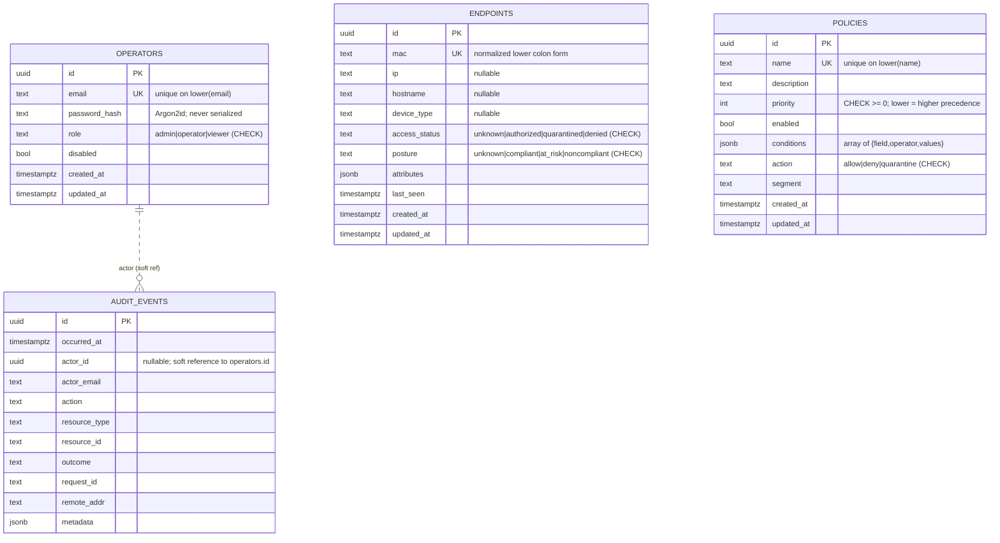

# Database Design & ERD

PostgreSQL is the system of record. This document describes the schema, the
rationale behind it, the entity-relationship diagram, and indexing/operational
considerations. The authoritative DDL lives in
`internal/storage/postgres/migrations/` and is applied by the embedded
migration runner (see [Migration Guide](migrations.md)).

## 1. Design principles

- **Application-generated UUID primary keys** — no sequential IDs to leak row
  counts; clients can generate IDs without a round trip.
- **`TIMESTAMPTZ` everywhere**, written in UTC by the application.
- **`JSONB` for open-ended data** (`attributes`, `conditions`, `metadata`) with
  GIN indexing where containment queries are useful.
- **CHECK constraints mirror the domain enums**, so the database stays a source
  of truth even if a buggy or malicious client bypasses service validation.
- **The audit table is append-only** — no `UPDATE`/`DELETE` paths exist in code.

## 2. Entity-relationship diagram

> **No hard foreign keys** link `audit_events.actor_id` to `operators.id`. This
> is intentional: the audit log must survive operator deletion to preserve the
> historical record. The reference is "soft" (the email is denormalized into
> the event). `endpoints` and `policies` are independent aggregates.

## 3. Tables

### `operators`
Administrative users. Uniqueness is enforced **case-insensitively** via a
unique index on `lower(email)`, regardless of whether the `citext` extension is
installed. Passwords are Argon2id-encoded in PHC string format.

### `endpoints`
Network devices keyed by normalized MAC (`endpoints_mac_uniq`). `attributes`
supports policy conditions under the `attr.` namespace and is GIN-indexed for
containment queries. Indexed on `access_status` (operator filtering) and
`hostname` (prefix search).

### `policies`
Ordered rules. The hot-path query —
`SELECT ... WHERE enabled ORDER BY priority` — is served by the **partial
index** `policies_enabled_priority_idx ON (priority) WHERE enabled`, which keeps
the index small and the enabled-policy fetch cheap. `conditions` is a JSONB
array deserialized into the domain `Condition` slice.

### `audit_events`
Append-only security log. Indexed on `occurred_at DESC` (recent-first listing),
`actor_id`, and `(resource_type, resource_id)` for investigations.

### `change_requests`, `change_request_revisions`, `change_request_validations` (0007)
Review-only change requests (ADR-0008 slice A; see
[the implementation plan](../architecture/implementation-plan-change-request-core.md)
on PR #2). A change request is a proposal for the policy rule set. Nothing in
these tables changes the active policy, a session, a CoA or a switch.

- **`change_requests`**
  - Holds the header (title, intent, `requested_by`), plus `workflow`, which
    is CHECKed to `review_only`.
  - `state` is CHECKed to `draft | validated | simulated | cancelled`; there
    is no approval or execution state.
  - `revision` points at the current revision.
  - Rows are updated by compare-and-set on `(state, revision)` under
    `SELECT … FOR UPDATE`. They are never deleted (trigger).
- **`change_request_revisions`**
  - One immutable row per revision, holding `rules` (JSONB),
    `default_action` and `content_digest` (the canonical `policyver.Digest`).
  - Also holds the immutable `policy_versions` row (`base_version_id`,
    `base_version_digest`) the revision was written against. There are no
    activation records yet, and none are invented.
- **`change_request_validations`**
  - One immutable row per validation of one revision, with the content
    digest, the environment digest and the result.
- **Immutability:** UPDATE and DELETE on revisions and validations are
  rejected by `nac_forbid_history_change()`.
- **Audit:** every mutation writes its `audit_events` row in the same
  transaction; if that insert fails, nothing commits.

### `schema_migrations`
Bookkeeping table created by the migration runner: `(version TEXT PK,
applied_at TIMESTAMPTZ)`.

## 4. Indexing summary

| Index | Table | Purpose |
|-------|-------|---------|
| `operators_email_lower_uniq` | operators | case-insensitive unique email |
| `endpoints_mac_uniq` | endpoints | MAC uniqueness + lookup |
| `endpoints_access_status_idx` | endpoints | status filtering |
| `endpoints_hostname_idx` | endpoints | hostname prefix search |
| `endpoints_attributes_gin` | endpoints | attribute containment |
| `policies_name_uniq` | policies | case-insensitive unique name |
| `policies_enabled_priority_idx` | policies | hot-path enabled-policy fetch |
| `audit_events_occurred_at_idx` | audit_events | recent-first listing |
| `audit_events_actor_idx` | audit_events | per-actor investigation |
| `audit_events_resource_idx` | audit_events | per-resource investigation |

## 5. Capacity & growth

- `endpoints` grows with the device population (typically 10³–10⁶). All access
  patterns are indexed point/range lookups.
- `audit_events` grows unbounded with activity. Plan a **retention/partitioning
  policy** (e.g. monthly partitions + archival) for high-volume deployments —
  see [Backup Strategy](../operations/backup-strategy.md). The access-evaluation
  path writes one coarse audit row per decision; tune verbosity if needed.
- `policies` is small (typically < 10³) and fully cacheable.

## 6. Consistency & transactions

Each migration applies inside its own transaction together with its
bookkeeping insert (all-or-nothing). Application writes are single-statement and
atomic; the platform does not currently require multi-statement transactions,
which keeps the persistence layer simple and the connection pool efficient.
