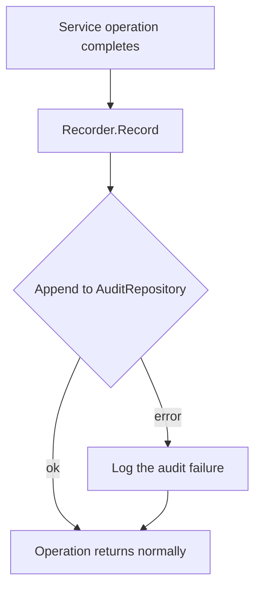

# Audit Logging

This document describes the NAC platform's audit subsystem: what is recorded, the
append-only guarantee, how events correlate to requests, the best-effort-versus-request
durability tradeoff, retention and growth, how to query the log, secret redaction, and
tamper-evidence considerations.

Audit is implemented in `internal/audit/audit.go` and persisted by the append-only
`audit_repo`. See [Low-Level Design §4.3](../architecture/low-level-design.md#43-internalauditauditgo)
and the [Database Schema](../database/schema.md) for the `audit_events` table. Related:
[AuthN/AuthZ](./authn-authz.md), [Threat Model](./threat-model.md).

---

## 1. What is audited

The `Recorder.Record(ctx, action, resourceType, resourceID, outcome, meta)` API captures a
uniform event for every security-relevant operation:

| Operation | `action` | `resource_type` | Typical `outcome` |
|-----------|----------|-----------------|-------------------|
| Operator login | `login` | `operator` | `success` / `failure` |
| Create endpoint | `endpoint.create` | `endpoint` | `success` / `failure` |
| Update endpoint | `endpoint.update` | `endpoint` | `success` / `failure` |
| Delete endpoint | `endpoint.delete` | `endpoint` | `success` / `failure` |
| Create policy | `policy.create` | `policy` | `success` / `failure` |
| Update policy | `policy.update` | `policy` | `success` / `failure` |
| Delete policy | `policy.delete` | `policy` | `success` / `failure` |
| Access evaluation | `access.evaluate` | `endpoint` | `success` (allowed) / `denied` |

Each event records:

| Field | Source |
|-------|--------|
| `actor` | the `Principal` in the request context (operator id/email; or the enforcement-point identity for evaluations) |
| `action` | the operation performed |
| `resource_type` / `resource_id` | the affected entity |
| `outcome` | one of `success`, `failure`, `denied` |
| `request_id` | the **trace span id** of the request (see [§3](#3-correlation-via-request_id)) |
| `remote_addr` | the caller address, pulled from context |
| `metadata` | arbitrary structured JSONB context for the event (e.g. matched policy id, reason) |
| `occurred_at` | event timestamp |

Outcomes carry distinct security meaning: `denied` specifically marks an access-control
refusal (a default-deny or a deny policy match), distinct from a `failure` (an error
processing the request).

---

## 2. Append-only guarantee

The audit log is **write-once**. This is enforced structurally, not merely by convention:

- **No update/delete in code.** `audit_repo` implements only *append* and *list* — there are
  **no** update or delete methods in the repository. Code physically cannot mutate or remove
  an event through the application.
- **No update/delete in the API.** There is no HTTP route to modify or delete audit events;
  `GET /api/v1/audit` is read-only (and `audit:read`-gated).

The combination means that, through the application surface, audit events can only be created
and read. Mutation would require direct database access outside the application — which is
exactly the boundary the tamper-evidence discussion in [§8](#8-tamper-evidence-considerations)
addresses.

---

## 3. Correlation via `request_id`

Every audit event's `request_id` is set to the **trace span id** of the originating request.
The `traceMiddleware` establishes a span per request; `Recorder.Record` reads that span id
from context. This gives a single correlation key that ties together:

- the structured **application log line** for the request,
- the **metrics** observed for that request, and
- the **audit event(s)** emitted while handling it.

To reconstruct an incident, find the `request_id` in the audit row and grep the application
logs for the same id — the audit event and its surrounding log context share the key.

---

## 4. Best-effort vs request tradeoff

A core design decision: **an audit-append failure is logged but does not fail the
operation.**



| Property | Behavior |
|----------|----------|
| Availability | A transient audit/database hiccup never blocks a legitimate operation. |
| Completeness | An audit write that fails is *logged* but the event is **not** retried/blocking, so the durable audit trail can have a gap under failure. |

This favors **request availability over audit completeness** — appropriate where the system's
job (admitting/denying devices) must not stall because the audit store is briefly unavailable.
The tradeoff is explicit and documented in code.

**How to tighten it** (when completeness must dominate availability):

1. Make the audit append part of the same transaction as the mutating operation, so the
   operation and its audit record commit or roll back atomically.
2. Buffer-and-retry: enqueue failed appends to a durable local queue and drain on recovery.
3. Mirror to an external sink (see [§8](#8-tamper-evidence-considerations)) and alert on the
   logged append-failure metric so gaps are detected promptly.

---

## 5. Retention, growth, and partitioning

`audit_events` is append-only and therefore grows monotonically. It is indexed for forensic
access — `occurred_at desc`, `actor`, and resource columns — but a multi-year, high-volume
table needs a retention plan:

- **Time-based partitioning.** Partition `audit_events` by `occurred_at` (e.g. monthly range
  partitions). Old partitions can be detached and archived/dropped cheaply, and the
  `occurred_at desc` query pattern prunes to recent partitions.
- **Retention policy.** Define how long online audit must remain queryable; archive older
  partitions to cold storage before pruning.
- **Backups.** Audit retention interacts with the backup/restore plan; see the
  backup-strategy documentation for snapshot cadence and restore expectations.

> Pointer: align audit retention and partition pruning with the backup-strategy doc so that
> archived partitions are captured before they are detached.

---

## 6. Querying the audit log

### Via the API (RBAC-gated)

```
GET /api/v1/audit
```

Requires the `audit:read` permission (granted to `admin`, `operator`, and `viewer` — see the
[RBAC matrix](./authn-authz.md#5-rbac-matrix)). Supports pagination (the standard `Page`
clamp: default 50, max 200) and the usual filtering for forensic queries.

### Directly in the database

For deep forensics, query the table directly (read-only credentials recommended):

```sql
-- Recent denials, newest first
SELECT occurred_at, actor, action, resource_type, resource_id, remote_addr, metadata
FROM audit_events
WHERE outcome = 'denied'
ORDER BY occurred_at DESC
LIMIT 100;

-- Everything a given actor did
SELECT occurred_at, action, resource_type, resource_id, outcome
FROM audit_events
WHERE actor = $1
ORDER BY occurred_at DESC;

-- Correlate to application logs / metrics by request id
SELECT * FROM audit_events WHERE request_id = $1;
```

The indexes on `occurred_at desc`, `actor`, and the resource columns back these access
patterns.

---

## 7. Log redaction of secrets

Audit events and structured logs must never persist secrets. The discipline:

- **Never log credentials.** Passwords, the Argon2id PHC hash, JWTs, and the service token are
  never written to audit `metadata` or application logs. Login events record the outcome and
  actor — never the submitted password.
- **Generic login outcomes.** Consistent with the
  [anti-enumeration](./authn-authz.md#8-login-anti-enumeration) design, login audit records
  `success`/`failure` without echoing the attempted credential.
- **Metadata hygiene.** Because `metadata` is free-form JSONB, callers must keep secrets out
  of it; treat it as potentially exportable to downstream sinks.

---

## 8. Tamper-evidence considerations

The application enforces append-only at the code and API layers ([§2](#2-append-only-guarantee)),
but a sufficiently privileged actor with **direct database access** could still alter rows.
Strengthening tamper-*evidence* (beyond tamper-resistance) is future work:

- **External WORM sink.** Mirror events to a write-once-read-many / immutable store (e.g. an
  append-only object-storage bucket with retention lock, or a managed immutable log). Even if
  the primary table is altered, the external copy provides an independent record.
- **Hash chaining.** Compute each event's hash over its contents plus the previous event's
  hash, forming a chain; any retroactive edit breaks the chain and is detectable.
- **Periodic sealing / signing.** Periodically sign a digest of the audit range with a key the
  database operator does not hold, anchoring integrity outside the database trust boundary.
- **Least privilege.** Application database credentials should hold only `INSERT`/`SELECT` on
  `audit_events` (never `UPDATE`/`DELETE`), reinforcing the code-level append-only guarantee at
  the database grant layer.

These measures move the audit trail from "append-only by application convention" toward
"provably tamper-evident", which matters most when the audit log is itself the evidence in a
security investigation.

---

## See also

- [Low-Level Design](../architecture/low-level-design.md) — audit recorder and storage
- [Database Schema](../database/schema.md) — `audit_events` table and indexes
- [AuthN/AuthZ](./authn-authz.md) · [Threat Model](./threat-model.md) ·
  [Trust Boundaries](./trust-boundaries.md)
- [Migration Guide](../database/migrations.md) — partitioning a growing table
- [Diagrams](../architecture/diagrams.md) — login & access-evaluation sequences
