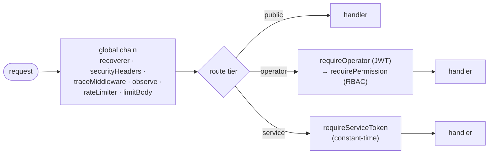

# Authentication & Authorization

This document specifies how the NAC platform authenticates callers and authorizes their
actions: operator JWTs, password storage, the service token used by enforcement points, the
RBAC permission matrix, per-route enforcement, fail-closed behavior, login anti-enumeration,
and the bootstrap admin.

The design decision is recorded in
[ADR-0004 — JWT + Argon2id + RBAC](../../adr/0004-auth-jwt-argon2-rbac.md). Related threats
and boundaries are in the [Threat Model](./threat-model.md) and
[Trust Boundaries](./trust-boundaries.md). Implementation details live in
[Low-Level Design §5.1](../architecture/low-level-design.md#51-internalauth).

---

## 1. Two distinct authentication paths

The platform has **two** kinds of caller, authenticated by two independent mechanisms that
are deliberately kept separate:

| Caller | Mechanism | Routes |
|--------|-----------|--------|
| **Operator** (human admin) | Bearer **JWT** (HS256), gated by RBAC | All `/api/v1/endpoints`, `/api/v1/policies`, `/api/v1/audit` |
| **Enforcement point** (machine) | Shared **service token** | `POST /api/v1/access/evaluate` |
| *(none)* | Public | `POST /api/v1/auth/login`, `GET /healthz` `/readyz` `/version` `/metrics` `/openapi.yaml` |

Keeping the service token separate from operator JWTs means a leaked enforcement-point
credential cannot be used to administer policy, and an operator token cannot be replayed at
the enforcement endpoint with elevated machine privileges. The two credential classes have
disjoint capabilities.

---

## 2. Operator JWT

Issued at login by `internal/auth/jwt.go`'s `TokenIssuer`.

- **Algorithm:** HS256. The signing key must be **>= 32 bytes** (enforced at construction).
- **TTL:** must be `> 0` (enforced). Tokens are short-lived by policy.
- **Claims set on `Issue`:**

  | Claim | Value |
  |-------|-------|
  | `sub` | operator id |
  | `email` | operator email |
  | `role` | operator role (`admin` / `operator` / `viewer`) |
  | `iss` | issuer |
  | `aud` | audience |
  | `iat`, `nbf`, `exp` | issued-at, not-before, expiry |
  | `jti` | unique token id |

### Validation on `Parse`

- **Pins HS256.** The parser accepts *only* HS256 and rejects `alg=none` and
  algorithm-confusion attempts (e.g. an attacker presenting an RS256/none token). This closes
  the classic JWT algorithm-confusion vulnerability.
- Validates `iss` and `aud` against the expected values.
- Validates `exp` and **requires** an expiry claim to be present — a token without an expiry
  is rejected rather than treated as non-expiring.

### Revocation tradeoff (disabled flag + short TTL)

JWTs are stateless: once issued they are valid until `exp`. The platform does **not** maintain
a server-side token blocklist. Revocation is achieved by two complementary means:

1. The operator record carries an **`enabled` flag**. Disabling an operator stops new logins
   immediately (login checks `enabled`).
2. **Short TTLs** bound the window during which an already-issued token for a now-disabled
   operator remains usable.

The accepted tradeoff: a disabled operator's *outstanding* token stays valid until it expires
(at most one TTL). This is the deliberate price of stateless tokens; the mitigation is to keep
TTLs short. If hard, immediate revocation becomes a requirement, the next step is a `jti`
denylist or token-version claim checked per request — see
[ADR-0004](../../adr/0004-auth-jwt-argon2-rbac.md).

---

## 3. Password storage

Implemented in `internal/auth/password.go`.

- **Algorithm:** Argon2id (memory-hard, the recommended password KDF).
- **Parameters:**

  | Parameter | Value |
  |-----------|-------|
  | memory | 64 MiB |
  | time (`t`) | 3 |
  | parallelism (`p`) | 2 |
  | salt length | 16 bytes |
  | key length | 32 bytes |

- **Encoding:** the standard PHC string,
  `$argon2id$v=19$m=<mem>,t=<time>,p=<par>$<base64-salt>$<base64-hash>`. The parameters travel
  *with* the hash, so verification reads them from the stored string.
- **Comparison:** constant-time, to avoid leaking information via timing.
- **Malformed input:** a PHC string that cannot be parsed yields `ErrInvalidHash` rather than
  a silent false-accept.

**Rehash-on-parameter-change (future).** Because the cost parameters are embedded in each
stored hash, the system can transparently upgrade them: on a successful login, compare the
stored parameters against the current target; if they are weaker, re-hash the just-verified
plaintext with the new parameters and persist it. This lets cost factors rise over time
without forcing a global password reset. (Hooked into the login path when needed.)

---

## 4. Service token (enforcement points)

`POST /api/v1/access/evaluate` is called by machines, not humans, and is guarded by
`requireServiceToken` middleware.

- The presented token is compared to the configured value in **constant time**
  (`requireServiceToken` uses a constant-time compare), preventing timing oracles.
- It is **separate from the JWT subsystem** — different credential, different middleware,
  different route tier. There is no RBAC on this route beyond possessing the token; the route
  grants exactly one capability: request an access decision.
- **Rotation.** The token is configuration-supplied; rotate it by updating configuration and
  redeploying/reloading, coordinating with enforcement points. Because the check is a simple
  constant-time equality, a brief overlap window (accepting old + new) can be arranged at the
  configuration layer during rotation if zero-downtime rotation is required.

---

## 5. RBAC matrix

`internal/auth/rbac.go` holds a **static** role→permission map. `HasPermission` is
**fail-closed**: an unknown or unmapped role has *no* permissions.

Permissions: `endpoint:read`, `endpoint:write`, `policy:read`, `policy:write`,
`access:evaluate`, `audit:read`, `operator:manage`.

| Permission | admin | operator | viewer |
|------------|:-----:|:--------:|:------:|
| `endpoint:read` | ✅ | ✅ | ✅ |
| `endpoint:write` | ✅ | ✅ | — |
| `policy:read` | ✅ | ✅ | ✅ |
| `policy:write` | ✅ | ✅ | — |
| `access:evaluate` | ✅ | ✅ | — |
| `audit:read` | ✅ | ✅ | ✅ |
| `operator:manage` | ✅ | — | — |

> The table reflects the intended role model: **admin** is full control including managing
> other operators; **operator** administers endpoints and policies and can evaluate access but
> cannot manage operators; **viewer** is read-only across endpoints, policies, and audit. The
> authoritative mapping is the static map in `rbac.go`; `HasPermission` denies anything not
> explicitly granted.

Note that `access:evaluate` as a *permission* applies to operator-context callers; the
enforcement-point path to `/access/evaluate` is authorized by the **service token**, not by
RBAC (see [§4](#4-service-token-enforcement-points)).

---

## 6. Per-route enforcement

Authorization is composed from middleware, layered per route (see
[router/middleware](../architecture/low-level-design.md#54-internalserver-and-pkg)):

- `requireOperator` validates the JWT and places the `Principal{ID, Email, Role}` into the
  request context.
- `requirePermission(<perm>)` then checks the principal's role against the required
  permission via the RBAC map. For example `POST /api/v1/policies` requires `policy:write`;
  `GET /api/v1/audit` requires `audit:read`.
- `requireServiceToken` guards only `/access/evaluate`.

---

## 7. Fail-closed behavior

The system denies by default everywhere it makes a security decision:

- **RBAC:** `HasPermission` returns false for unknown roles / unmapped permissions.
- **JWT:** anything other than a valid HS256 token with correct `iss`/`aud`/`exp` is rejected
  (`401`). `alg=none` and confusion attempts are rejected.
- **Service token:** a missing or mismatched token is rejected.
- **Policy engine:** no matching policy → **default deny**; unknown condition operator → the
  condition fails to match (see [ADR-0003](../../adr/0003-default-deny-policy-engine.md) and
  the [engine algorithm](../architecture/low-level-design.md#3-internalaccess--the-policy-engine-and-service)).

Authorization outcomes map to HTTP via the
[error table](../architecture/low-level-design.md#error-mapping-domain-sentinel--http--rfc-7807):
`ErrUnauthorized → 401`, `ErrForbidden → 403`.

---

## 8. Login anti-enumeration

`POST /api/v1/auth/login` is designed to leak no information about which emails exist:

- **Generic 401.** Whether the email is unknown, the account is disabled, or the password is
  wrong, the response is the *same* generic `401` — never a distinguishing message like "no
  such user" vs "wrong password".
- **Constant work.** When the operator is not found (or is disabled), the handler still
  performs a dummy Argon2id verification so the response time does not betray account
  existence via timing. Combined with Argon2id's constant-time compare on the real path, the
  timing signal is flattened.

Both `success` and `failure` outcomes are recorded to the audit log (see
[Audit Logging](./audit-logging.md)).

---

## 9. Bootstrap admin

To solve the cold-start problem (an empty `operators` table cannot log in to create the first
operator), the composition root in `cmd/nacd/main.go` performs an **optional bootstrap admin**
step: when configured, it ensures an initial `admin` operator exists (credentials supplied via
configuration, password stored as an Argon2id PHC hash like any other). This step is:

- **Optional** — driven by configuration; skipped if not set.
- **Idempotent in intent** — it does not clobber an existing operator set; it seeds the first
  admin so the platform is administrable on first boot.

Operational guidance: bootstrap with a strong, configuration-supplied credential, log in,
create the real operator accounts with appropriate roles, then disable or rotate the bootstrap
credential.

---

## See also

- [ADR-0004 — JWT + Argon2id + RBAC](../../adr/0004-auth-jwt-argon2-rbac.md)
- [Threat Model](./threat-model.md) · [Trust Boundaries](./trust-boundaries.md)
- [Audit Logging](./audit-logging.md)
- [Low-Level Design](../architecture/low-level-design.md) · [Diagrams](../architecture/diagrams.md)
- [Architecture Overview](../architecture/overview.md)
