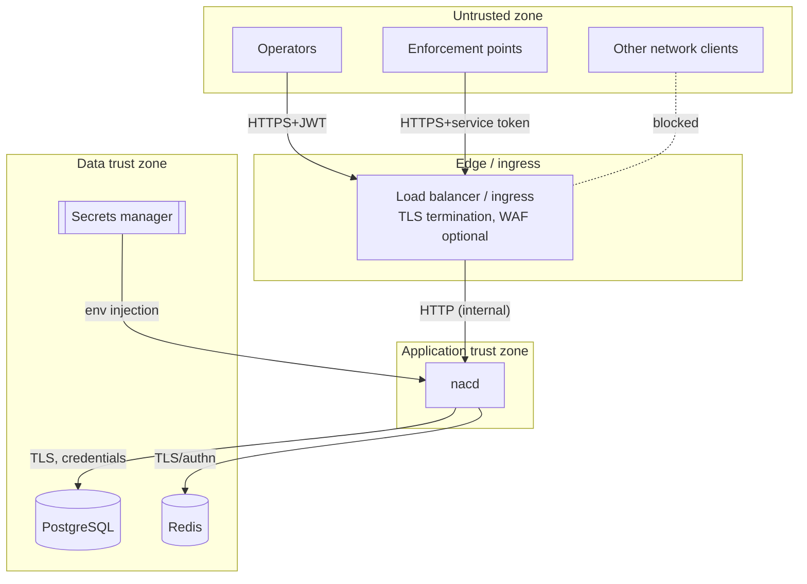
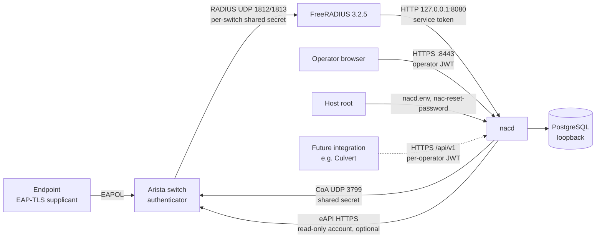

# Trust Boundaries

A trust boundary is a point where data or control crosses between zones of
differing trust. At each boundary the platform authenticates, validates, and/or
encodes. This document enumerates the boundaries and the controls applied at
each.

## Boundary 1 — Internet/clients → Edge (ingress/LB)

- **Crossing:** Operator and enforcement-point HTTPS traffic.
- **Controls:** TLS termination, optional WAF, network ACLs restricting which
  sources may reach the API. TLS is **not** handled by `nacd` itself; it must be
  terminated here (or by a sidecar) and `nacd` must never be exposed in
  plaintext to untrusted networks.

## Boundary 2 — Edge → `nacd` (API)

- **Crossing:** Every HTTP request enters the application.
- **Controls (per the middleware stack):**
  - **AuthN:** JWT (operators) or service token (enforcement points), selected
    per route.
  - **AuthZ:** RBAC permission check per route.
  - **Input validation:** strict JSON decoding (unknown fields rejected),
    domain validation (MAC normalization, IP/length/enum checks), body-size cap.
  - **Output encoding:** JSON with `nosniff`; errors as RFC 7807 with no
    internal detail.
  - **Abuse controls:** per-client rate limiting; panic recovery; security
    headers.

## Boundary 3 — `nacd` → PostgreSQL

- **Crossing:** Persistence of all durable state.
- **Controls:** Parameterized queries only (no string interpolation);
  least-privilege DB role; TLS (`sslmode=require` or stricter) in production;
  credentials from the secrets manager. CHECK constraints enforce domain
  invariants server-side (defense in depth).

## Boundary 4 — `nacd` → Redis

- **Crossing:** Caching the enabled-policy set.
- **Controls:** Redis is treated as **untrusted for integrity**: cached values
  are JSON, and a decode failure is treated as a cache miss (fail open to DB),
  so a corrupted or hostile cache cannot inject a malformed policy into a
  decision. Use AUTH + TLS and network isolation in production. No secrets are
  stored in Redis.

## Boundary 5 — Secrets manager → `nacd`

- **Crossing:** Delivery of the JWT signing key, service token, and datastore
  credentials.
- **Controls:** Secrets are injected as environment variables at runtime (e.g.
  via External Secrets Operator / Vault Agent), validated at startup (minimum
  lengths enforced outside development), never logged, and rotatable. See
  [Secrets Management](../operations/secrets-management.md).

## Boundary 6 — `nacd` → Enforcement points (decision response)

- **Crossing:** The access decision returned to the enforcement point.
- **Controls:** The decision is the only data returned; it contains no operator
  or credential data. The enforcement point is responsible for actuating the
  decision (VLAN assignment, ACL). A compromised enforcement point can only
  affect devices within its own enforcement domain.

## Pilot deployment (single control node)

The pilot installs nacd, FreeRADIUS 3.2.5 and PostgreSQL on one Ubuntu
24.04 node (`deployments/pilot/install.sh`). TLS for operators is served by
nacd itself (`NAC_HTTPS_ADDR`, default `:8443`); plaintext HTTP listens on
loopback only (`127.0.0.1:8080`), for FreeRADIUS.

### Boundary 7 — Switch → FreeRADIUS

- **Crossing:** RADIUS Access-Request and accounting from each registered switch.
- **Controls:**
  - FreeRADIUS accepts only clients in the nacd-generated client file
    (`/var/lib/nac/freeradius-clients.conf`, `0640 nac:freerad`). Each switch
    has its own shared secret, and the stock `testing123` localhost client is
    removed.
  - EAP-TLS is validated by FreeRADIUS against the configured CA. Requests
    without EAP, MAB included, are rejected in `authorize` before nacd is
    asked (`scripts/e2e-freeradius.sh` checks this).
  - TLS session resumption is disabled.

### Boundary 8 — FreeRADIUS → nacd

- **Crossing:** One `rlm_rest` call per decision (`/api/v1/radius/authorize`,
  `/reject`, `/accounting`) over loopback.
- **Controls:**
  - Authenticated with the service token (HTTP Basic). The token grants no
    operator capability.
  - nacd trusts FreeRADIUS for the facts it verified: certificate validity,
    issuer, serial and CN, and the NAS attributes of a packet whose shared
    secret it checked. Everything else comes from NAC's own records.
  - Every value nacd returns is sent with `do_xlat=false`, so it cannot
    trigger FreeRADIUS string expansion.
  - **Fail closed:** if nacd is unreachable or errors, FreeRADIUS rejects and
    writes an outage line that nacd imports later. There is no authorization
    cache.

### Boundary 9 — nacd → switch (CoA)

- **Crossing:** CoA-Request to the switch's `nas_ip:coa_port`.
- **Controls:**
  - RFC 5176 authenticator with the switch's shared secret, and the response
    authenticator is verified, so a forged ACK is rejected.
  - Retransmissions are byte-identical, at most one CoA is in flight per
    session, and a request is never re-targeted.
  - Only operators with `session:act` can request a CoA, and each request is
    attributed to them.

### Boundary 10 — nacd → switch (eAPI, optional)

- **Crossing:** HTTPS `POST /command-api` running `show dot1x hosts`.
- **Controls:**
  - Basic auth with a per-switch account; use a read-only role.
  - The password is sealed at rest with `NAC_SECRETS_KEY` (AES-GCM).
  - Observations are evidence for operators (freshness, liveness, "matches
    requested"), never an input to authorization decisions.
- **Gap:** certificate verification is all or nothing.
  `NAC_EAPI_INSECURE_SKIP_VERIFY=true` disables it for every switch, which
  the self-signed eAPI certificates on vEOS require. Per-switch certificate
  pinning is not implemented.

### Boundary 11 — Operator browser → console and API

- **Crossing:** The static console (`/ui/`) and every operator action.
- **Controls:**
  - The console is served same-origin with a restrictive CSP and renders
    only with `textContent`. It holds the JWT in `sessionStorage` and calls
    only the documented `/api/v1` API, so it has no privileged back door.
  - Every request is authorized server-side per operation, against the
    operator record (see [AuthN & AuthZ](authn-authz.md)).
  - The default certificate is self-signed; replace it for production use.

### Boundary 12 — Host root → nacd

- **Crossing:** Configuration and recovery on the control node.
- **Controls:**
  - `/etc/nac/nacd.env` (`0640 root:nac`) holds the database password, JWT
    key, service token and `NAC_SECRETS_KEY`.
  - `nac-reset-password` (root only) resets an operator's password with the
    same policy as the API, revokes that operator's sessions and is audited.
  - Root on the control node is fully trusted, so protect host access
    accordingly.

### Boundary 13 — Future integration (e.g. Culvert) → nacd

- Not implemented. The supported contract is described in
  [Integration boundary](../architecture/integration-boundary.md).
- An integration calls the documented `/api/v1` API with **per-operator**
  credentials, so authorization and attribution stay server-side in nacd.
- It must never hold the FreeRADIUS service token.

## Data classification

| Data | Classification | At rest | In transit |
|------|----------------|---------|-----------|
| Operator password hashes | Secret | Argon2id in PostgreSQL | TLS |
| JWT signing key, service token | Secret | Secrets manager | env injection |
| Policies, endpoints | Internal | PostgreSQL (+ Redis cache) | TLS |
| Audit events | Internal (integrity-critical) | PostgreSQL (append-only) | TLS |
| Metrics | Internal (non-sensitive) | in-memory / Prometheus | scrape |
| Switch RADIUS secrets, eAPI passwords | Secret | AES-GCM sealed with `NAC_SECRETS_KEY` in PostgreSQL; RADIUS secrets also in clear in the FreeRADIUS client file (`0640 nac:freerad`) | loopback / never returned by the API except an audited config reveal |
| Certificate identities, decisions with inputs, session timelines | Internal | PostgreSQL | TLS (operator API) |
| Operator token version | Internal (integrity-critical) | PostgreSQL | not exposed |
