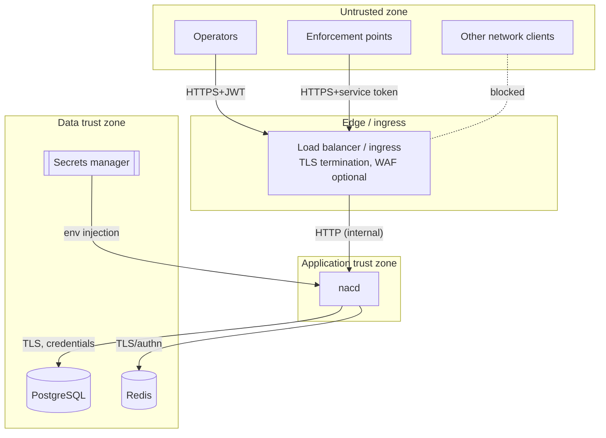

# Trust Boundaries

A trust boundary is a point where data or control crosses between zones of
differing trust. At each boundary the platform authenticates, validates, and/or
encodes. This document enumerates the boundaries and the controls applied at
each.

## Boundary 1 — Internet/clients → Edge (ingress/LB)

- **Crossing:** Operator and enforcement-point HTTPS traffic.
- **Controls:** TLS termination, optional WAF, network ACLs restricting which
  sources may reach the API. TLS is **not** handled by `nacd` itself; it must be
  terminated here (or by a sidecar) and `nacd` must never be exposed in
  plaintext to untrusted networks.

## Boundary 2 — Edge → `nacd` (API)

- **Crossing:** Every HTTP request enters the application.
- **Controls (per the middleware stack):**
  - **AuthN:** JWT (operators) or service token (enforcement points), selected
    per route.
  - **AuthZ:** RBAC permission check per route.
  - **Input validation:** strict JSON decoding (unknown fields rejected),
    domain validation (MAC normalization, IP/length/enum checks), body-size cap.
  - **Output encoding:** JSON with `nosniff`; errors as RFC 7807 with no
    internal detail.
  - **Abuse controls:** per-client rate limiting; panic recovery; security
    headers.

## Boundary 3 — `nacd` → PostgreSQL

- **Crossing:** Persistence of all durable state.
- **Controls:** Parameterized queries only (no string interpolation);
  least-privilege DB role; TLS (`sslmode=require` or stricter) in production;
  credentials from the secrets manager. CHECK constraints enforce domain
  invariants server-side (defense in depth).

## Boundary 4 — `nacd` → Redis

- **Crossing:** Caching the enabled-policy set.
- **Controls:** Redis is treated as **untrusted for integrity**: cached values
  are JSON, and a decode failure is treated as a cache miss (fail open to DB),
  so a corrupted or hostile cache cannot inject a malformed policy into a
  decision. Use AUTH + TLS and network isolation in production. No secrets are
  stored in Redis.

## Boundary 5 — Secrets manager → `nacd`

- **Crossing:** Delivery of the JWT signing key, service token, and datastore
  credentials.
- **Controls:** Secrets are injected as environment variables at runtime (e.g.
  via External Secrets Operator / Vault Agent), validated at startup (minimum
  lengths enforced outside development), never logged, and rotatable. See
  [Secrets Management](../operations/secrets-management.md).

## Boundary 6 — `nacd` → Enforcement points (decision response)

- **Crossing:** The access decision returned to the enforcement point.
- **Controls:** The decision is the only data returned; it contains no operator
  or credential data. The enforcement point is responsible for actuating the
  decision (VLAN assignment, ACL). A compromised enforcement point can only
  affect devices within its own enforcement domain.

## Data classification

| Data | Classification | At rest | In transit |
|------|----------------|---------|-----------|
| Operator password hashes | Secret | Argon2id in PostgreSQL | TLS |
| JWT signing key, service token | Secret | Secrets manager | env injection |
| Policies, endpoints | Internal | PostgreSQL (+ Redis cache) | TLS |
| Audit events | Internal (integrity-critical) | PostgreSQL (append-only) | TLS |
| Metrics | Internal (non-sensitive) | in-memory / Prometheus | scrape |
